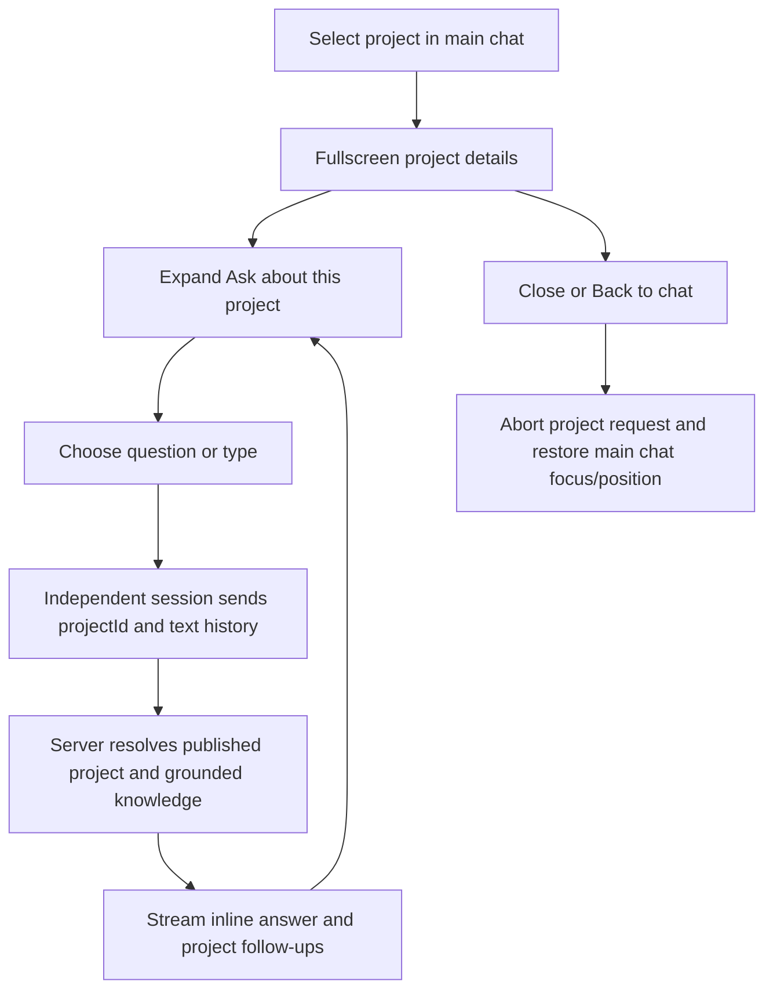

# Feature spec — Focused project details and questions

**Status:** Implemented; unit/code checks pass; browser review deferred

## Goal

Replace the split artifact overlay with a full-window detail view. Visitors can read a project and open a compact, initially collapsed Q&A section below its overview without returning to the main chat. Work starts from checkpoint `45b8c46` on `codex/project-detail-overlay`.

## User story

As a visitor, I want to explore a project and ask about its implementation in one focused view, then return to the same place in my main conversation.

## Requirements

- [x] R1 — Use a fullscreen shared Dialog with stable dimensions, a title, Back to chat/Close controls, keyboard dismissal, focus containment, and focus restoration without scrolling the main chat.
- [x] R2 — Remove the embedded chat column, expanding width/height animation, and artificial one-second loading delay. Keep the main chat mounted behind the overlay.
- [x] R3 — Show existing project details immediately. Experience artifacts use the same focused shell without project questions.
- [x] R4 — Put an initially collapsed “Ask about [project]” section below the project overview. Offer three grounded starter questions, a labeled composer, streamed inline answers, and contextual follow-ups. No entrance animation or separate scrolling chat column.
- [x] R5 — Give Q&A its own in-memory conversation. Collapsing retains it; closing aborts an active response and discards that project session. Reopening or choosing another project starts fresh. Main chat messages, draft, and position are unaffected.
- [x] R6 — Reuse `/api/chat` and the existing grounded response pipeline with an optional validated `projectId`. Resolve only published projects on the server, bind pronouns and follow-ups to that project, load its full knowledge plus public card facts, and never route a project question to a global display tool.
- [x] R7 — Exclude client system messages and non-text parts from project model history. Return a clear generic UI error on failed requests; allow stop, clear, and retry. Suppress follow-up choices while busy or failed.
- [x] R8 — Preserve normal main-chat routing, project-list browsing without a model call, the global AI follow-up flag, project links, and current card presentation. Stay inside this app.

## System boundaries

| In scope | Out of scope |
| --- | --- |
| `features/project-details/`, integration in `Chat` and `FeaturedProject`, scoped extension to `features/ai-chat/` | Shared package source, workspace config, V2, persistence, deployment |
| Legacy artifact shim and app docs/tests | New model provider, separate project routes, redesigning project content |

## API

`POST /api/chat` accepts existing `{ messages }` or project-mode `{ messages, projectId }`. A supplied ID must match a published project. Project-mode history is validated/bounded text-only user/assistant messages, ending in a user question. The server supplies project facts and scope; client content is not a source of portfolio facts. Existing UI-message streaming and `data-related` parts are reused.

## File structure

```text
features/project-details/
  components/detail-overlay.tsx     # Stable fullscreen dialog
  components/project-detail.tsx     # Existing details + overview Q&A slot
  components/project-questions.tsx  # Compact collapsible Q&A
  hooks/use-project-questions.ts    # Independent request/session lifecycle
  lib/project-context.ts           # Server-resolved scope and public facts
  lib/project-questions.ts         # Grounded question choices/history helpers
```

## Component responsibilities

| Component | Responsibility |
| --- | --- |
| DetailOverlay | Modal/focus/scroll shell, with one content column |
| ProjectDetail | Compose the existing detail content and project Q&A |
| ProjectQuestions | Collapsible controls, inline answers, busy/error states |
| useProjectQuestions | Independent useChat, draft, sends, clear/stop, abort on unmount |
| Project context helpers | Validate ID/history, bind routing, add server-owned facts |

## Flow



## Routes (thin)

No new route. `app/api/chat/route.ts` remains a thin export.

## Out of scope

- Saving Q&A across overlay closures or injecting it into the main thread.
- Automatically fixing shared dependency/build issues.

## Acceptance criteria

The requirements are implemented. Browser acceptance below remains unverified under the user’s code-only verification preference.

- [ ] Project and experience details use the stable full-window shell with no embedded chat.
- [ ] Main transcript, draft, and viewport survive opening/closing and project answers.
- [x] Server tests verify selected-project grounding/routing for pronoun-only and global-shaped questions, and project-only follow-ups.
- [x] Unit tests cover unknown/unpublished IDs, invalid history, cancellation propagation, duplicate sends, and clear/unmount races. Browser error/retry/close cases are added but unrun.
- [x] Desktop/mobile, focus/Escape, request abort, errors/retry, and isolation browser cases are added; execution remains deferred.
- [x] Unit tests, typecheck/build results, tracker, registry, and UI patterns are recorded accurately.

## Implementation prompt

Implement the approved focused detail experience using existing shared primitives and grounded AI. Keep the feature owned under `features/project-details/`; reuse the current content and API paths rather than duplicating portfolio data or the main chat UI.

## Verification — 2026-10-16

- Checkpoint `45b8c46` saved the prior app state on `codex/chat-welcome-transition`; implementation is on `codex/project-detail-overlay`. Generated test results and unrelated workspace changes are excluded.
- All 193 unit tests pass in 28 files, including 32 new project context, API, streaming, and session-action cases. Provider calls are mocked in these checks.
- Typecheck reports only the existing missing shared `radix-ui` dependency in the admin form’s Label. Production build fails on the same single dependency error. No shared source or dependency configuration changed.
- Tailwind compilation verifies fullscreen dimensions and disabled content entrance animation. Source checks confirm no embedded main chat, size animation, or artificial loading timer remains in the overlay.
- Four browser cases in `e2e/project-detail-overlay.spec.ts` cover isolation/draft/position/focus, mobile typed questions/clear, close cancellation, and generic errors/retry. They have not been run, in accordance with the user’s standing code-only verification preference. No live-provider or visual verification is claimed.

## UI review

| Before | After | Why |
| --- | --- | --- |
| Main conversation duplicated in a narrow side column | Focused project details with a collapsed contextual Q&A below the overview | Keep questions close to the project without a second main-chat interface |
| Overlay dimensions expand while chat initializes, followed by a loading timer | Stable fullscreen Dialog with immediate local details | Remove the resizing/duplicated-chat sequence implicated in the scroll investigation |
| Project questions would modify the main conversation | Separate in-memory project session, aborted/discarded on close | Preserve the main thread and draft while asking in place |
