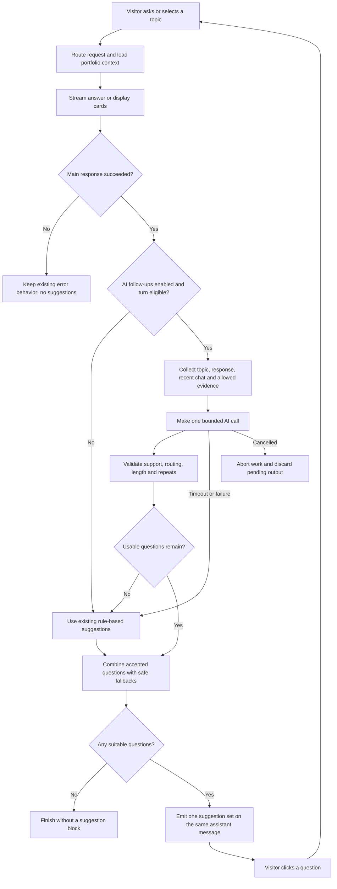

# Feature spec — AI follow-up questions

**Status:** V1 implemented and verified locally — release checks blocked

**Release scope:** V1, with an advanced version outlined below

**Extends:** [Dynamic Suggestions, DS9](./06-dynamic-suggestions.md#optional-enhancement-stage-15--not-required-for-ship)

**Registry:** [Feature index](../00-index.md)

The owner authorized completing V1 end to end on 2026-10-14. Context, generation, validation, streaming, cancellation, and the feature flag are implemented on `codex/ai-follow-up-foundation`. The feature defaults off; the local verification server runs with it enabled. Production checks remain blocked by the existing shared dependency and font-fetch issues below.

## Problem and goal

The current follow-ups vary by intent and portfolio data, but their wording comes from predefined templates. Although the generator receives the assistant's text, its templates do not use that text. Suggestions can therefore miss the interesting details in the latest answer and repeat broad navigation options.

Make the next questions reflect the current topic, the response or cards just shown, and recent conversation. Questions must lead to answers supported by the public portfolio content. Keep the existing chat, cards, and Related Questions controls.

## User story

As a visitor exploring Eric's background, experience, or technologies, I want relevant next questions so I can investigate the details that interest me without having to invent the next prompt.

Illustrative questions, shown only when the content supports them:

| Current conversation | Possible next question |
|----------------------|------------------------|
| Experience highlighting component libraries | How have you used Storybook in your design system work? |
| Tech stack highlighting React | How have you used React in your projects? |
| About Eric highlighting AI work | What AI projects have you built? |
| Overview of CodeDrill | What was the hardest part of CodeDrill? |

These are examples, not a fixed question bank or new claims about Eric.

## V1 behavior

1. The visitor types a message or chooses an existing sidebar/initial suggestion.
2. The current chat pipeline streams its answer or displays its tool cards.
3. After successful response content, an eligible turn gets one optional AI call to produce up to three follow-up questions.
4. Validate the questions, remove repeats, and fill gaps with safe questions from the existing rule-based path. Prefer two or three questions; show fewer or none when there are not enough suitable options.
5. Emit one suggestion set for that assistant message using the existing `data-related` stream part. Clicking a question sends its exact text as the next user message.

An eligible turn concerns About, Experience, Tech, a named published project, AI/design-system experience, or a general portfolio question with supporting context. Here, "selected topic" means the latest chat request, including a sidebar preset; opening an artifact alone does not trigger generation.

Project-list requests retain their local response and rule-based suggestions with **zero model calls**, even when this feature is enabled. Initial empty-state suggestions, clarification turns, mock mode, and the legacy path retain their existing behavior. A failed main response emits no follow-ups. A cancelled request discards pending suggestion output.

## Flow diagram



## Requirements

| ID | Requirement |
|----|-------------|
| AF1 | Generate short, natural questions from the current topic and completed response. At least one should deepen that topic when evidence supports it. Do not require a generic navigation question on every turn. |
| AF2 | Include the latest request, the completed assistant text, a concise summary of displayed tool facts, and the latest six user/assistant text messages. Use suggestions attached to those recent messages to discourage repetition. Tool-only responses must work without assistant prose. |
| AF3 | Ground questions in allow-listed public `knowledge/` content and server-produced portfolio tool facts. Reuse the existing maximum of three loaded knowledge files; do not scan the corpus or read internal `docs/` as model content. Available sections in those loaded files may support follow-ups beyond the sections used in the main answer. |
| AF4 | Return internal structured candidates with question text, a server-assigned source ID, and a short supporting excerpt. Reject unknown sources and excerpts absent from supplied evidence. Technology names alone do not support questions about undocumented usage, impact, or personal history. These checks aid grounding; semantic answerability still requires evaluation. |
| AF5 | Keep each question at most 80 characters. Reject overlong or incomplete questions rather than cutting their wording. Remove normalized exact duplicates, the latest question, and recently offered exact repeats. Ask the model to avoid semantic repeats and questions the recent answer already resolves. |
| AF6 | Every retained question must route to its intended subject and supporting knowledge through the existing `routeIntent()` path. Name the project explicitly in project questions. Avoid ambiguous prompts such as "How did you build it?", unknown projects, and unpublished projects. Cover career and technology questions in routing tests. |
| AF7 | Make at most one extra model call per eligible turn, with no retries. Defaults: a 3,000 ms budget for supplementary work and 16,000 characters of input content. Bound history, response, tool summaries, and evidence deterministically, retaining the current topic and complete supporting excerpts before older history; skip the model call when usable evidence cannot fit. Never delay the first visible answer content for suggestion work. |
| AF8 | Feature disabled, missing evidence, timeout, provider failure, malformed output, or rejected candidates must leave the successful main answer intact. Filter fallback templates for routing, publication visibility, and recent repeats before filling gaps; omit the suggestion block if no suitable questions remain. |
| AF9 | Associate output with the same assistant message. Abort supplementary work on cancellation/disconnection. Clearing chat or starting another turn must not allow late questions to appear in the new turn. Emit at most one final suggestion set before the enclosing UI stream finishes, with no competing static `related` block or premature stream closure. |
| AF10 | Use a separate server flag `AI_FOLLOW_UP_QUESTIONS_ENABLED=true`, defaulting off. It also requires the Knowledge Assistant path to be enabled. Keep the existing OpenAI integration and ephemeral chat model. Treat visitor text and source content as data rather than generation instructions. No new browser credentials or stored conversation history. |

The server budget ends when optional model work is stopped or completed. Measure visible suggestion timing separately: the current `Related` component also has a one-second reveal delay. Do not advertise the model deadline as a complete UI latency guarantee.

Implemented defaults: six recent text messages, 16,000 characters of input content, 800 output tokens, a 3,000 ms model deadline, and no retries. Excerpts are matched contiguously after normalizing Markdown emphasis, whitespace, casing, and typographic quotes; words and numbers remain intact. Validation also rejects undocumented favorites and unsupported claims of building a named design system merely used in the source.

## System boundaries

| In scope for V1 | Deferred or out of scope |
|------------------|--------------------------|
| Current response, displayed facts, and bounded recent chat | Full-session topic memory or visitor profiles |
| One structured generation call and lightweight validation | Multiple generation/ranking calls or learned ranking |
| Existing controls and stream contract | A chat redesign, new endpoint, or artifact-click tracking |
| Time limit, cancellation, fallback, and feature flag | Persistent cache, dashboards, analytics collection, or A/B testing |
| Published portfolio evidence | New portfolio facts, external research, vector search, or a database |
| App-local changes | Shared package changes or a new model provider |

## API and implementation boundaries

Keep `POST /api/chat` and its request format. The client receives the existing shape:

```ts
{ type: "data-related", data: { suggestions: string[] } }
```

Source IDs and excerpts stay server-side. Normalize context from existing messages and the server's actual tool output; the current `toSimpleModelMessages()` helper retains only text, so it cannot supply displayed card facts or prior `data-related` questions by itself.

### Implementation

- `buildFollowUpContext()` returns bounded prompt input, source IDs, repeat-check metadata, and a generation eligibility/skip reason. It admits only the three candidate knowledge paths and published project files, with a three-file cap. Displayed technology lists are marked as display evidence rather than narrative evidence.
- `serializeFollowUpContext()` defines the payload checked against the 16,000-character content budget. A response excerpt is reserved before complete evidence sections are packed; remaining response text, suggestions, and recent messages use the remaining space. Exact repeat metadata survives prompt trimming. The subsequent generator must use this serialization.
- `validateFollowUpQuestions()` checks evidence, routing, repeats, and unsupported assumptions, then fills remaining slots with safe fallbacks. It can return fewer than two questions or an empty set. Structural generation constraints are separate from per-candidate validation so one overlong question does not discard otherwise valid candidates.
- `generateAiFollowUps()` uses the existing `models.chat` OpenAI model and a structured `generateObject()` call. The prompt requests short contiguous quotes, response-aware questions, and wording compatible with current routing. A deadline races and aborts the provider call; failures produce filtered fallbacks, while cancellation produces no output.
- `runChatStream()` captures actual tool results by tool-call ID, streams main content first, and emits suggestions before the held finish event. Main text/tool failures suppress follow-ups. Project-list requests retain their zero-model-call early return.
- `post-chat.ts` passes the flag, original UI messages, and request abort signal. The chat provider stops previous requests before sending a new turn and uses an action version to protect resets and rapid sends. Word-copy streaming observes cancellation too.
- Context and validation helpers remain pure. Diagnostics include intent, outcome, timing, counts, and rejection categories; question text, excerpts, and conversation bodies are not logged.

Implemented modules:

```text
features/ai-chat/
  types/follow-up-context.ts             # implemented context and evidence contracts
  lib/generate-ai-follow-ups.ts          # OpenAI call, structured output, timeout
  utils/build-follow-up-context.ts       # bounded history, cards, evidence sources
  utils/validate-follow-up-questions.ts   # shape, evidence, routing, repeats
  api/run-chat-stream.ts                 # integrate after successful response content
  api/post-chat.ts                       # pass request cancellation and feature flag
```

Reuse `generate-suggestions.ts` and `suggestion-templates.ts` as the fallback. The existing `features/chat-ui/components/message.tsx` and `components/related.tsx` remain the rendering path. No new feature folder or barrel export is needed.

## Acceptance criteria and validation

| Scenario | Required result |
|----------|-----------------|
| About, experience, and tech responses | Questions reflect supplied response details. Two fixtures with the same intent but different content produce appropriately different questions. |
| Card-only experience/tech response | Suggestions use the displayed facts and available narrative evidence despite empty assistant text. |
| Named project and multi-turn conversation | Questions include the correct published project name, resolve to the supporting route, and avoid recent repeats. A clicked question receives a relevant supported answer. |
| Invalid model output or unsupported question | Invalid schema, unknown sources, fabricated excerpts, overlong questions, wrong routing, and unpublished project references are rejected; safe fallbacks fill remaining slots. |
| Slow, failing, or disabled generator | Main content appears before supplementary work completes. Work is bounded, with no retry or chat error caused by the suggestion call. Missing evidence skips generation. |
| Failed or cancelled main response; clear/reset | Failed main responses show no suggestions. Cancelled or obsolete work emits nothing into a later turn. |
| Show projects with the flag enabled | Cards, links, details, and existing suggestions still work with zero model calls. |

### Verification and release

- [x] All 154 unit tests pass, including context, candidate rejection, fallback, routing, timeout/cancellation, partial invalid output, and zero-call project-list coverage.
- [x] All 11 targeted browser checks pass: About/Experience/Tech controls and question clicks, delayed content, reset and superseding turns, project navigation, and error-alert recovery. Supplementary failure fallback is covered in unit/stream tests and was observed in the live browser.
- [x] Reviewed representative fixture questions and live About, Tech, Experience, and TypeScript follow-up samples. Live review exposed unsupported favorites and design-system authorship assumptions; prompt guidance and rejection tests now cover both. Formatting-only excerpt changes are tolerated, while altered numbers and non-contiguous quotes remain rejected. Semantic answerability still requires judgment beyond these checks.
- [x] Ran typecheck and build. Typecheck reports only the existing missing `radix-ui` dependency in the shared design system. Build fails on that dependency and blocked Google Fonts fetches. Shared packages remain outside this task's scope.
- [x] Updated registry/tracker with implementation status, flag, limits, and release blockers.
- [ ] Resolve the dependency/font-fetch blockers and obtain passing production checks before marking the registry Shipped or enabling a broad rollout.

### Enable locally

Restart the dev server with:

```sh
AI_FOLLOW_UP_QUESTIONS_ENABLED=true pnpm dev
```

The flag defaults off. `KNOWLEDGE_ASSISTANT_ENABLED=false` and `CHAT_MOCK_STREAM=true` bypass AI follow-ups. Opening an artifact alone does not trigger generation.

SDK references: [structured generation and cancellation](https://v5.ai-sdk.dev/docs/reference/ai-sdk-core/generate-object), [UI stream lifecycle](https://ai-sdk.dev/docs/reference/ai-sdk-core/stream-text).

## Advanced production version

After V1 has been evaluated, a separate phase may add full-session topic coverage, several candidates ranked for relevance and diversity, versioned caching, stronger grounding evaluation, aggregate usage/cost measurements, and controlled rollout comparisons. Define each phase's storage, metrics, and budget before implementation. These capabilities are a roadmap, not V1 acceptance criteria.

## Future decisions

- Tune model configuration or the three-second budget from measured results. V1 uses the existing model, six recent text messages, and the 16,000-character content cap.
- Whether artifact selections should affect suggestions in a later phase; V1 responds to chat turns only.

## Implementation prompt

For maintenance, read this spec, the existing [Dynamic Suggestions spec](./06-dynamic-suggestions.md), and [progress tracker](../../context/progress-tracker.md). Preserve the project-list path and existing error behavior. Scope advanced capabilities separately. Keep the flag off by default and describe remaining release blockers accurately.
